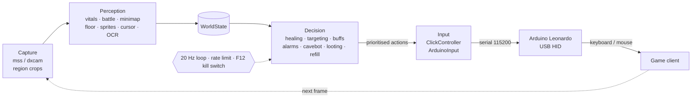

# Moonlight

[](https://github.com/Mascotte33/Moonlight/actions/workflows/ci.yml)


A learning project in real-time computer vision and hardware input: a CPU-only
automation pipeline for a Tibia-style game client that reads the screen, decides
what to do, and acts through an Arduino Leonardo emulating a USB keyboard and
mouse.

The project has a second purpose: it is an experiment in **managing AI coding
agents**. Every line of code, test and documentation in this repository was
generated by AI agents; my role was scoping, task design, review and the
hands-on hardware steps. See [Built by AI agents](#built-by-ai-agents).

## Technical highlights

- **20 Hz loop on low-spec hardware** — capture → perception → decision → input
  must fit a 50 ms budget with no GPU. Perception works on small region crops,
  never full frames.
- **Hardware-offloaded input** — custom Arduino Leonardo firmware with a serial
  protocol, 1 s heartbeat and watchdog: if the host goes silent, the board
  releases every key.
- **Closed-loop clicking** — move, read the rendered cursor back from the
  screen, correct to within ±2 px, then click; fail closed if the cursor is not
  found.
- **Golden-frame testing** — 200 real client frames, labelled, drive replay
  tests for every perception module.
- **Safety-first loop** — priority state machine, rate limiting, F12 kill
  switch, and a dedicated safety-invariant test suite.
- **Strict tooling** — `mypy --strict`, ruff, and CI on every push.

## Architecture



```
moonlight/
├── core/         the engine: loop, safety, wiring, WorldState, config
├── healing/      heal and cure logic + its tab
├── targeting/    target picking, attack hotkeys + its tab
├── cavebot/      walking, pathing, route recorder + its tab
├── looting/      looting logic
├── refill/       refill trigger (start %)
├── scripts/      user scripts
├── extras/       buffs
├── alarms/       danger alarms
├── calibration/  screen-region finder, profiles + its tab
├── hardware/     Arduino input backends, closed-loop clicking + its tab
├── perception/   reading the game: screen capture + HP/MP, battle list, minimap, …
├── gui/          the window shell and the dashboard, diagnostics, settings, status tabs
├── profiles/     saved calibration profiles (<name>.json)
└── x11.py        Linux desktop calls
```

A feature is one folder: its logic in `<feature>.py`, its GUI tab in `tab.py`.

| Path | Contents |
|---|---|
| `moonlight/core/loop.py` | 20 Hz priority state machine |
| `moonlight/core/safety.py` | Wire-level rate limit, F12 kill switch, operator alert |
| `moonlight/core/wiring.py` | Builds the bot loop from config + profile (`build_loop`) |
| `moonlight/core/state.py` | `WorldState`, the snapshot shared between perception and decision |
| `moonlight/core/config.py` | Bot config (`BotConfig`), kept apart from the logic |
| `moonlight/perception/` | `capture.py` (mss / dxcam, DPI-aware, focus) and the readers: HP/MP, battle list, minimap, floor, monster sprites, cursor, server-log OCR |
| `moonlight/gui/` | Desktop GUI shell (customtkinter) |
| `firmware/` | Arduino Leonardo HID firmware and [wire protocol](firmware/README.md) |
| `tests/` | Unit tests at the top level; golden, replay, safety, perf and hardware-in-the-loop suites ([details](tests/README.md)) |
| `tools/` | Benchmarks, Arduino verification, labelling and calibration helpers ([details](tools/README.md)) |
| `docs/` | Client UI layout, hardware budget, [PR docs](docs/prs/) and [task files](docs/tasks/) |

## Feature status

| Feature | Implemented | Tested | Working |
|---|:-:|:-:|:-:|
| Screen capture | ✅ | ✅ | 🟡 |
| Region calibration | ✅ | ✅ | 🟡 |
| HP / MP reading | ✅ | ✅ | 🟡 |
| Battle list reading | ✅ | ✅ | 🟡 |
| Minimap position + floor | ✅ | ✅ | 🟡 |
| Monster sprite detection | ✅ | ✅ | ❌ |
| Server-log OCR | ✅ | ✅ | ❌ |
| Healing + cures | ✅ | ✅ | 🟡 |
| Targeting | ✅ | ✅ | 🟡 |
| Buffs | ✅ | ✅ | ❌ |
| Alarms | ✅ | ✅ | ❌ |
| Cavebot (waypoint routing, route recorder) | ✅ | ✅ | ❌ |
| Looting | ✅ | ✅ | ❌ |
| Refill (check, say, key, drag waypoints) | ✅ | ✅ | ❌ |
| User scripts (script and wait waypoints, timers) | ✅ | ✅ | ❌ |
| Extras (food, haste, buff, ring, amulet, player timer, PM alarm) | ✅ | ✅ | ❌ |
| Account rotation (timed accounts, logout at the depot, next login) | ✅ | ✅ | ❌ |
| Arduino HID input | ✅ | ✅ | 🟡 |
| Closed-loop clicking | ✅ | ✅ | 🟡 |
| Kill switch + safety stops | ✅ | ✅ | ❌ |
| Desktop GUI | ✅ | ✅ | ❌ |

**Tested** — covered by passing automated tests. **Working** — ✅ verified in a
full live game session; 🟡 partial: verified on real hardware or real
screenshots, but not yet in a full session; ❌ not yet verified live. The first
full live session has not happened yet.

The route recorder saves the tile the character stood on, never the one it is
walking to: a position counts after it held for 0.6 s, or once the character
stepped off it. Recording stops and saves the route when the cavebot starts. Walking
over stairs or into a hole records a `stairs` waypoint on that tile, so the
route plays back across floors; for a ladder (or a sewer grate: Ladder too),
rope or shovel click its button while standing on the tile you use it from. While recording, every
waypoint button adds a waypoint on the character's tile.

Looting presses the loot hotkey (the OTS loots every corpse around on
Alt+Q) after each kill and again when the battle list empties, then stands
still for the set wait (400 ms by default) before walking on. It is skipped
while HP is below the set percent. Set it in Cavebot > Loot.

Refill is part of the waypoint list. A `check` waypoint with label `town`
jumps to label `town` when used capacity reaches the start % (Cavebot >
Refill) or after **Refill now** is pressed; otherwise the bot walks past it.
The town section uses `say` (types its label into chat and presses Enter, for
NPC talk like `hi`, `deposit all`, `yes`), `key` (presses its label as a
hotkey) and `drag` (label `x1 y1 x2 y2` in client pixels: drags the left
button from one spot to the other, such as the loot backpack onto the depot
stash). Edit route shows the cursor in client pixels for drag labels. End
the town section with a `goto` back to the hunt. Drag needs the firmware's
`H` / `R` mouse commands: reflash the Leonardo.

A `wait` waypoint holds the route for its label in seconds. A `script`
waypoint runs `scripts/<label>.py`; Cavebot > Scripts runs scripts on a timer
too (`eat 60, rope 5`: name and seconds), while Scripts is on in Settings. A
script is a Python generator `run(bot)` that yields commands one at a time,
so the bot heals in between:

```python
def run(bot):
    if bot.mana > 90:             # also bot.hp, bot.cap (used %)
        yield bot.say("utevo lux")
    yield 2                       # wait 2 seconds
    spot = bot.find("rope.png")   # a picture in scripts/, None when not seen
    if spot:
        yield bot.click(*spot)    # client pixels, right=True for a right click
    yield bot.press("f5")
    yield bot.goto("town")        # walk on from route label town
```

A running script pauses walking and waits during a fight or looting; healing
always goes first. An error in a script is logged and stops that script only.

Extras (Settings > Extras) press a hotkey when a picture shows: food when
hungry, ring or amulet when its slot is empty, haste while walking without
haste or a protection zone, the buff potion when its icon is gone and at least
N monsters are in the battle list. Cut each picture from a screenshot into
`data/templates/icons/` (`hungry`, `haste`, `pz`, `buff`, `ring_empty`,
`amulet_empty`, `pm`, all `.png`); an extra without its picture never presses.
For the player timer, calibrate the optional `player_list` area: a second
battle list set to players only. A player staying there longer than the set
minutes sends the character to refill or sounds the alarm; with Extras on,
players passing by no longer alarm. A private message tab sounds the alarm
too. Every alarm saves a screenshot in `screenshots/` (the newest 20 stay).

Account rotation plays accounts in turn (A, B, C, A...) in one client window.
List them in the config file (`configs/<name>.json`, never published) under
`modules.rotation.accounts`: `login`, `password` (letters and digits only),
`character` (its place in the character list, 1 = the first) and `minutes`
(clock time from its login). Put a `script` waypoint with label `rotate` at the
depot of the town section. When an account's time is up the next `check`
waypoint goes to town; at `rotate` the bot presses the logout hotkey (Settings
> Account rotation, Ctrl+L by default), types the next account's login and
password, picks the character and walks on. An account that does not log in
within 30 s is skipped; when none does, the bot alarms and stops. Passwords
show as `press (hidden)` in the command log. Every account plays the same
route and settings. Scripts can type too: `bot.type("abc")`.

## Getting started

Requirements: Windows, Python 3.12+, an Arduino Leonardo for real input
(optional — without one the bot runs against a fake input backend), and
[Tesseract](https://github.com/tesseract-ocr/tesseract) if you want server-log OCR.

```bash
# 1. Install (from the repo root)
pip install -e .

# 2. Flash firmware/moonlight/moonlight.ino to the Leonardo (see firmware/README.md),
#    then check the connection
python tools/arduino_verify.py

# 3. Calibrate the screen regions in the GUI's Calibration tab (step 5 opens the GUI)

# 4. Check the setup (config, Arduino, profile, perception)
python tools/check_setup.py

# 5. Launch the desktop GUI (or double-click "Start Moonlight GUI.bat")
python -m moonlight
```

Use `python -m moonlight --no-bot` to open the GUI without starting the bot loop.

## Healing and cures

Healing presses your action-bar hotkeys. It never types spell names. Set it up
in the GUI's Healing tab, or in the `healing` section of your profile config:

- **Rules** are checked top to bottom. Each has a kind (`spell` or `potion`), a
  hotkey, an HP trigger (`hp_below_percent`), an MP trigger
  (`mp_below_percent`) and a mana floor (`minimum_mana_percent`). 0 means unused.
- Each tick sends the first due spell and the first due potion, so both can
  land together. Spells and potions have their own cooldowns
  (`spell_cooldown_ms`, `potion_cooldown_ms`, default 1000).
- **Cures** read the condition icons next to the HP bar (poison, burn,
  electrify, bleeding, paralyse). Each has an on/off switch and a hotkey
  (default `shift+F1` to `shift+F5`, all off). A cure never replaces a needed
  heal spell.
- Healing needs the `status_icons` region in the Calibration tab for cures.
- Targeting reads the chase mode from the `chase_buttons` region (auto-find in the Calibration tab).

Default rules: F2 spell below 50% HP, F1 spell below 85% HP, F3 potion below
40% HP, F4 potion below 30% MP. Old configs with `emergency_spell` and similar
keys are refused at load. Rewrite the section to the new shape.

## Targeting

Targeting clicks a monster's name in the battle list, then presses its
attack hotkey. Turn it on with the **Targeting on** switch at the top of
the Targeting tab (grayed while the bot is paused). Set it up in that tab,
or in the `targeting` section of your profile config:

- **Monster rows** match a battle-list name (ignoring case). Each has a
  priority (1-5, higher first), `ignore` ("never attack" in the tab), an
  attack `hotkey` (empty = melee only), a mana floor (`minimum_mana_percent`)
  and a `movement`: `follow` (chase) or `none` (stand still). Players are
  never targeted.
- **`default_monster`** is the row for every monster without its own row, so
  everything is attacked unless you ignore it. The tab shows it as "all others".
  Default: priority 1, F6, 10% mana, follow.
- The bot picks the highest priority, then the lowest HP, then the closest
  row. It finishes the current target even when a higher priority monster
  comes, and never clicks it twice (a second click untargets). A selected
  "never attack" monster is left for the next one.
- **Area rules** press a hotkey when at least `minimum_adjacent_monsters`
  creatures stand next to you and MP is at least `minimum_mana_percent`.
  Default: F5 at 3 monsters, 30% mana. A rule is used only while it is
  ticked (`enabled`). A ticked rule is grayed in the tab so it isn't edited
  by accident. All attack keys share `attack_cooldown_ms` (default 2000).
- **Unreachable:** when the target's HP stands still for
  `unreachable_after_seconds` (default 8), the bot takes one step toward it.
  After the same time again, it skips that monster for 30 s.
- **Chase mode:** each monster row is "chase" or "stand still". The bot reads
  the active (red) chase button from the `chase_buttons` region (Calibration
  tab) and, when it differs from the target's row, presses
  `toggle_chase_hotkey` ("Client key: Toggle Chase Mode" in the tab) before
  attacking. Bind the same key to Toggle Chase Mode in the client's hotkey
  options. With an empty key the bot attacks in the current mode and logs
  one warning ("set the Toggle Chase Mode key"). No `chase_buttons` region
  leaves the mode as it is.
- **Cavebot walking keys:** the cavebot holds the step key down while the
  way goes on in the same direction, so the character walks without a pause
  between tiles. A turn lets go and holds the new key; a fight, a stop, a
  floor change or a pause lets go.
- **Cavebot around monsters:** with walk keys on, the cavebot reads the
  monsters' health bars in the game view before every step and walks around
  them when that costs at most 8 more steps, instead of bumping into them.
- **Cavebot when blocked:** a step key that does not move the player in
  0.7 s is pressed once more (a lag looks the same); a second miss marks
  that tile blocked for 12 s (freed early once the monster on it
  walks off). The cavebot takes the cheapest way to the waypoint around
  blocked tiles and monsters, diagonals included (Q/E/Z/C, the
  client's WASD-mode diagonals; a diagonal costs 3 straight steps). **Stuck** means no way around,
  or a way more than 8 steps longer, after a bump: with monsters in the battle list
  targeting takes over with every monster attacking, never-attack rows
  included (players never), even with targeting off. Attack spells and area rules work as
  usual. After each kill the cavebot looks for a way again and walks on
  once there is one, back to your own targeting. With nothing to fight it tries
  every tile it has not bumped into yet; with none left it skips the
  waypoint (`cavebot: waypoint N unreachable, skipping` in the log) and the
  next ones until one on its floor has a way. When none has, or the route
  goes 60 s without moving, the route stops with the stuck alarm. Diagonals need the client's chat off (WASD walking).
- **Monster names** match ignoring capital letters ("cave rat" = "Cave Rat").
- **Seen monsters:** each new battle-list entry is saved with its picture
  (icon and name, in `<profile>.seen_monsters/`) and a tesseract name guess.
  The Targeting tab lists the ones with no monster row yet: the picture,
  then the guessed name (filled in once tesseract reads it). Correct the
  name, then click **Add to monsters** and the line leaves the list. The ✕
  forgets a line and its picture (it is learned again on its next sighting). You name
  each monster kind once. Without tesseract the guesses stay empty and you
  type the names. Only gray name text counts, and new names are learned only
  while the client is the foreground window, so other windows covering it
  don't create fake monsters.
- **Timing log:** every 10 s `logs/bot.log` gets a `tick timing:` line
  (average, screen-reading share, max), and each restart logs its reason
  (`bot restarts: ...`). The log rotates at 5 MB and keeps 3 old files, so a
  restart doesn't wipe the last run.

Client setup: the battle list must show monsters (players may be filtered
out) and be sorted by distance. Actions are logged to `logs/bot.log`.

## Development

The suite is verified green on Python 3.13 (a plain system install; the repo has
no `.venv`).

```bash
pip install -e ".[dev]"
ruff check .
mypy .
pytest -q
```

CI runs ruff, mypy, the test suite and the capture/perception benchmarks on every
push. The golden screenshot set (~585 MB) is kept out of the repository; tests
that need it skip when it is missing.

## Built by AI agents

Moonlight is 100% AI-generated. It doubles as my practice ground for running a
multi-agent software project: breaking work into tasks, writing briefs,
verifying output and keeping agents inside clear boundaries.


**How it works**

- **Orchestrator** — one agent owns the task queue (~50 tasks with
  dependencies), writes a self-contained brief for each task and is the only
  writer of the project tracker.
- **Role-based agents** — coder, QA, hardware and software research, and a
  senior reviewer. Each starts fresh from [RULESET.md](RULESET.md), its task file
  and the folder README, so no agent depends on another's memory.
- **Verify gate** — an agent's own "done" is never trusted: the orchestrator
  re-runs the full test suite, ruff and `mypy --strict` and reviews the diff
  before committing.
- **Independent review** — a senior-review agent audited the finished pipeline
  and produced 27 findings (3 critical), which were then fixed in batches
  grouped by how tightly the code was coupled.
- **Human gates** — the steps only a person can do: flashing the Arduino,
  providing real screenshots, and the live test session.
- **Models** — [Claude Code](https://claude.com/claude-code) with Claude models
  selected according to the complexity of each task, plus local Qwen models via
  llama.cpp when the Claude quota was exhausted.

**Guardrails.** Some requested or proposed features were declined outright and
recorded as such: anti-cheat evasion, input "humanizing" to disguise
automation, hiding the bot process or window, hardware-ID spoofing, and support
for official servers. Setting those boundaries early kept every agent's scope
unambiguous.

**What I learned managing agents**

- **One writer per shared state.** Two orchestrator sessions once edited the
  repo in parallel and produced diverging layouts; reconciling took a dedicated
  takeover. Since then, one orchestrator is the sole writer.
- **Verify, don't trust.** Agents report success optimistically. Status is
  established by test runs and diffs, not by what the tracker or the agent says.
- **Plan for interruptions.** Account session limits cut agents off
  mid-refactor. Committing work-in-progress and writing resume briefs turned
  those stops into short pauses instead of lost work.
- **Split work by coupling, not by count.** Splitting a batch into one agent per
  task was about 3× slower and saved no quota; grouping tightly coupled fixes
  together worked better.
- **Local models need sequential work.** The local llama.cpp backend stalled
  when several agents ran at once; running them one at a time fixed it.
- **A separate reviewer catches what builders miss.** The review pass found
  critical wiring and safety issues that every coder agent's tests had passed.

## License

MIT
