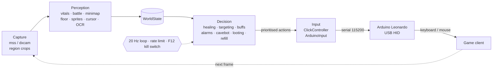
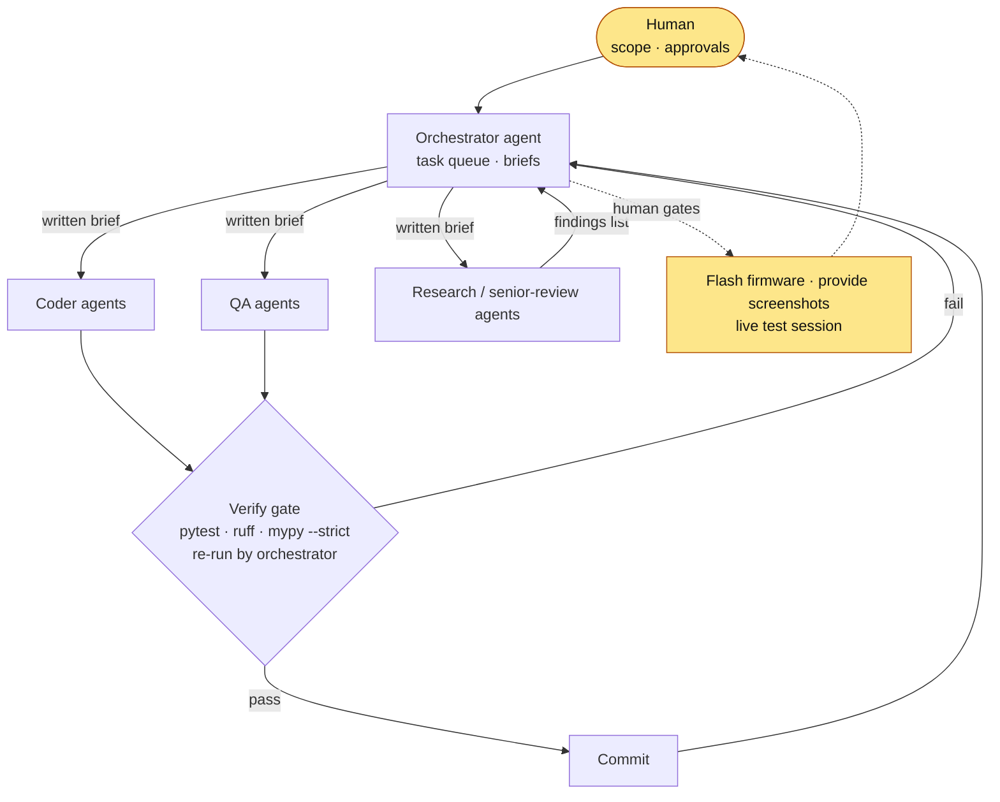

# Moonlight

[](https://github.com/Mascotte33/Moonlight/actions/workflows/ci.yml)


A learning project in real-time computer vision and hardware input: a CPU-only
automation pipeline for a Tibia-style game client that reads the screen, decides
what to do, and acts through an Arduino Leonardo emulating a USB keyboard and
mouse.

The project has a second purpose: it is an experiment in **managing AI coding
agents**. Every line of code, test and documentation in this repository was
generated by AI agents; my role was scoping, task design, review and the
hands-on hardware steps. See [Built by AI agents](#built-by-ai-agents).

## Technical highlights

- **20 Hz loop on low-spec hardware** — capture → perception → decision → input
  must fit a 50 ms budget with no GPU. Perception works on small region crops,
  never full frames.
- **Hardware-offloaded input** — custom Arduino Leonardo firmware with a serial
  protocol, 1 s heartbeat and watchdog: if the host goes silent, the board
  releases every key.
- **Closed-loop clicking** — move, read the rendered cursor back from the
  screen, correct to within ±2 px, then click; fail closed if the cursor is not
  found.
- **Golden-frame testing** — 200 real client frames, labelled, drive replay
  tests for every perception module.
- **Safety-first loop** — priority state machine, rate limiting, F12 kill
  switch, and a dedicated safety-invariant test suite.
- **Strict tooling** — `mypy --strict`, ruff, and CI on every push.

## Architecture



| Path | Contents |
|---|---|
| `moonlight/capture.py` | Client-window capture (mss, optional dxcam), DPI-aware, focus detection |
| `moonlight/calibrate.py` | Screen-region calibration → `moonlight/profiles/<name>.json` |
| `moonlight/perception/` | Readers: HP/MP, battle list, minimap, floor, monster sprites, cursor, loot window, server-log OCR |
| `moonlight/state.py` | `WorldState` — the snapshot shared between perception and decision |
| `moonlight/decision/` | Healing, targeting, buffs, alarms, cavebot, looting, refill |
| `moonlight/loop.py` | 20 Hz priority state machine, rate limiting, kill switch |
| `moonlight/input.py`, `clicker.py` | Input backends (`ArduinoInput`, `FakeInput`) and closed-loop clicking |
| `moonlight/gui/` | 10-tab desktop GUI (customtkinter) |
| `moonlight/cli.py` | `moonlight` command: `run`, `profiles`, `calibrate`, `check` |
| `firmware/` | Arduino Leonardo HID firmware and [wire protocol](firmware/README.md) |
| `tests/` | Unit, golden, replay, safety, perf and hardware-in-the-loop suites ([details](tests/README.md)) |
| `tools/` | Benchmarks, Arduino verification, labelling and calibration helpers ([details](tools/README.md)) |
| `docs/` | Client UI layout, hardware budget, [performance profile](docs/perf_profile.md), review findings |

## Feature status

| Feature | Implemented | Tested | Working |
|---|:-:|:-:|:-:|
| Screen capture | ✅ | ✅ | 🟡 |
| Region calibration | ✅ | ✅ | 🟡 |
| HP / MP reading | ✅ | ✅ | 🟡 |
| Battle list reading | ✅ | ✅ | 🟡 |
| Minimap position + floor | ✅ | ✅ | 🟡 |
| Monster sprite detection | ✅ | ✅ | ❌ |
| Server-log OCR | ✅ | ✅ | ❌ |
| Healing | ✅ | ✅ | ❌ |
| Targeting | ✅ | ✅ | ❌ |
| Buffs | ✅ | ✅ | ❌ |
| Alarms | ✅ | ✅ | ❌ |
| Cavebot (waypoint routing) | ✅ | ✅ | ❌ |
| Looting | ✅ | ✅ | ❌ |
| Refill route | ✅ | ✅ | ❌ |
| User script runner | ✅ | ✅ | ❌ |
| Arduino HID input | ✅ | ✅ | 🟡 |
| Closed-loop clicking | ✅ | ✅ | 🟡 |
| Kill switch + safety stops | ✅ | ✅ | ❌ |
| Desktop GUI | ✅ | ✅ | ❌ |

**Tested** — covered by passing automated tests. **Working** — ✅ verified in a
full live game session; 🟡 partial: verified on real hardware or real
screenshots, but not yet in a full session; ❌ not yet verified live. The first
full live session has not happened yet.

## Getting started

Requirements: Windows, Python 3.12+, an Arduino Leonardo for real input
(optional — without one the bot runs against a fake input backend), and
[Tesseract](https://github.com/tesseract-ocr/tesseract) if you want server-log OCR.

```bash
# 1. Install (from the repo root)
pip install -e .

# 2. Flash firmware/moonlight/moonlight.ino to the Leonardo (see firmware/README.md),
#    then check the connection
python tools/arduino_verify.py

# 3. Calibrate the screen regions for your client window
moonlight calibrate my-profile

# 4. Launch the desktop GUI
python -m moonlight.gui
```

Use `python -m moonlight.gui --no-bot` to open the GUI without starting the bot loop.

## Development

The suite is verified green on Python 3.13 (a plain system install; the repo has
no `.venv`).

```bash
pip install -e ".[dev]"
ruff check .
mypy .
pytest -q
```

CI runs ruff, mypy, the test suite and the capture/perception benchmarks on every
push. The golden screenshot set (~585 MB) is kept out of the repository; tests
that need it skip when it is missing.

## Built by AI agents

Moonlight is 100% AI-generated. It doubles as my practice ground for running a
multi-agent software project: breaking work into tasks, writing briefs,
verifying output and keeping agents inside clear boundaries.



**How it works**

- **Orchestrator** — one agent owns the task queue (~50 tasks with
  dependencies), writes a self-contained brief for each task and is the only
  writer of the project tracker.
- **Role-based agents** — coder, QA, hardware and software research, and a
  senior reviewer. Each starts fresh from its brief plus a short instructions
  file in every folder, so no agent depends on another's memory.
- **Verify gate** — an agent's own "done" is never trusted: the orchestrator
  re-runs the full test suite, ruff and `mypy --strict` and reviews the diff
  before committing.
- **Independent review** — a senior-review agent audited the finished pipeline
  and produced 27 findings (3 critical), which were then fixed in batches
  grouped by how tightly the code was coupled.
- **Human gates** — the steps only a person can do: flashing the Arduino,
  providing real screenshots, and the live test session.
- **Models** — [Claude Code](https://claude.com/claude-code) with Claude models
  selected according to the complexity of each task, plus local Qwen models via
  llama.cpp when the Claude quota was exhausted.

**Guardrails.** Some requested or proposed features were declined outright and
recorded as such: anti-cheat evasion, input "humanizing" to disguise
automation, hiding the bot process or window, hardware-ID spoofing, and support
for official servers. Setting those boundaries early kept every agent's scope
unambiguous.

**What I learned managing agents**

- **One writer per shared state.** Two orchestrator sessions once edited the
  repo in parallel and produced diverging layouts; reconciling took a dedicated
  takeover. Since then, one orchestrator is the sole writer.
- **Verify, don't trust.** Agents report success optimistically. Status is
  established by test runs and diffs, not by what the tracker or the agent says.
- **Plan for interruptions.** Account session limits cut agents off
  mid-refactor. Committing work-in-progress and writing resume briefs turned
  those stops into short pauses instead of lost work.
- **Split work by coupling, not by count.** Splitting a batch into one agent per
  task was about 3× slower and saved no quota; grouping tightly coupled fixes
  together worked better.
- **Local models need sequential work.** The local llama.cpp backend stalled
  when several agents ran at once; running them one at a time fixed it.
- **A separate reviewer catches what builders miss.** The review pass found
  critical wiring and safety issues that every coder agent's tests had passed.

## License

MIT
