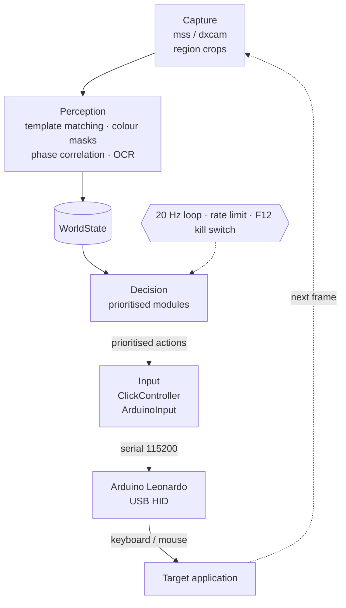
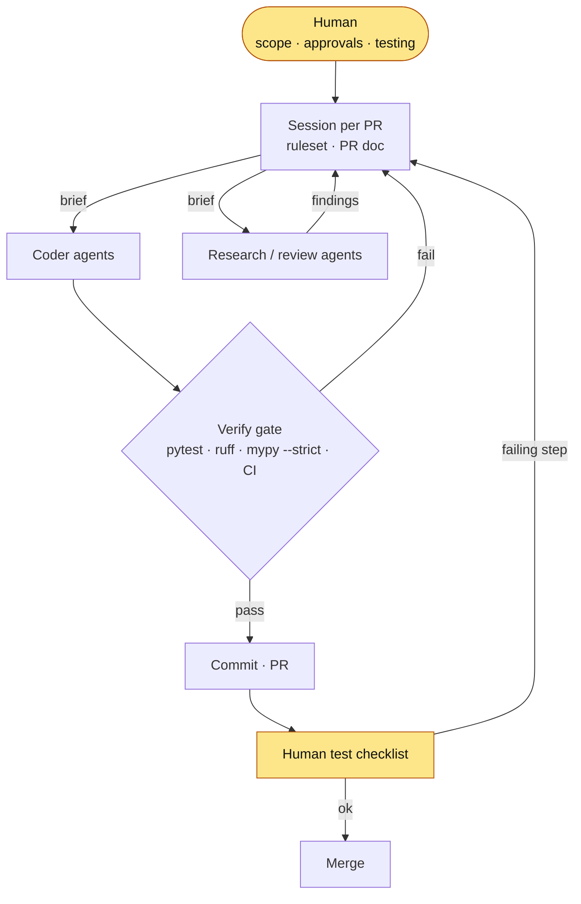

# Moonlight

[](https://github.com/Mascotte33/Moonlight/actions/workflows/ci.yml)


A learning project in real-time computer vision and hardware input: a CPU-only
pipeline that reads a desktop application's screen, decides what to do, and
acts through an Arduino Leonardo emulating a USB keyboard and mouse.

The project has a second purpose: it is an experiment in **managing AI coding
agents**. Every line of code, test and documentation in this repository was
generated by AI agents; my role was scoping, task design, review and the
hands-on hardware steps. See [Built by AI agents](#built-by-ai-agents).

## Technical highlights

- **20 Hz loop on low-spec hardware** — capture → perception → decision → input
  fits a 50 ms budget with no GPU. Perception works on small region crops,
  never full frames.
- **Fast, DPI-aware capture** — dxcam (Desktop Duplication) on Windows, about
  12× faster than mss in a live measurement; mss on Linux. Multi-monitor aware.
- **Classic computer vision, no ML** — OpenCV template matching
  (`TM_CCOEFF_NORMED`), colour masks, digit shape matching and phase
  correlation; Tesseract OCR only where text is free-form.
- **Position tracking from two sources** — dead reckoning from how far a map
  view slides between frames, fused with template matching against a tiled
  world map; a poor match never overrides a confident count.
- **Grid path planning** — Dijkstra over a per-tile cost map with diagonals,
  dynamic obstacles read from the screen, replanning whenever they move, and
  temporary blocked-tile memory.
- **Hardware-offloaded input** — custom Arduino Leonardo firmware with a
  line-based serial protocol and a watchdog: if the host goes silent for 10 s,
  the board releases every key.
- **Closed-loop clicking** — move, read the rendered cursor back from the
  screen, correct to within ±2 px, then click; fail closed if the cursor is not
  found.
- **Auto-calibration** — screen regions are found from anchor images, saved as
  per-monitor profiles, and rejected when the layout changes.
- **User scripting** — scripts are Python generators that yield one command at
  a time, so the main loop keeps its priorities between steps.
- **Golden-frame testing** — 200 real labelled frames drive replay tests for
  every perception module.
- **Safety-first loop** — priority state machine, wire-level rate limiting, an
  F12 kill switch, fail-fast errors, and a dedicated safety-invariant test suite.
- **Cross-platform** — Windows and Linux (X11 via python-xlib).
- **Strict tooling** — `mypy --strict`, ruff, a pre-commit hook, and CI on every
  push.

## Tech stack

| Area | Technology |
|---|---|
| Language | Python 3.12+ (fully typed, `mypy --strict`) |
| Vision | OpenCV, NumPy |
| OCR | Tesseract via pytesseract |
| Capture | dxcam (Windows), mss (Linux) |
| Input | Arduino Leonardo (C++ firmware, USB HID), pyserial at 115200 baud |
| GUI | customtkinter |
| Desktop integration | Win32 APIs, python-xlib (X11) |
| Tests | pytest, pytest-benchmark, golden-frame replay, hardware-in-the-loop |
| Quality | ruff, mypy, GitHub Actions |

## Architecture



```
moonlight/
├── core/         the engine: loop, safety, wiring, WorldState, config
├── perception/   screen capture and the image readers
├── hardware/     Arduino input backends, closed-loop clicking
├── calibration/  screen-region finder and profiles
├── gui/          the window shell, dashboard, diagnostics and settings
├── <feature>/    one folder per decision module: logic + its GUI tab
└── x11.py        Linux desktop calls
```

| Path | Contents |
|---|---|
| `moonlight/core/loop.py` | 20 Hz priority state machine |
| `moonlight/core/safety.py` | Wire-level rate limit, F12 kill switch, operator alert |
| `moonlight/core/wiring.py` | Builds the loop from config + profile (`build_loop`) |
| `moonlight/core/state.py` | `WorldState`, the snapshot shared between perception and decision |
| `moonlight/perception/` | Capture (mss / dxcam, DPI-aware) and the image readers |
| `firmware/` | Arduino Leonardo HID firmware and its serial protocol |
| `tests/` | Unit, golden, replay, safety, perf and hardware-in-the-loop suites |
| `tools/` | Benchmarks, Arduino verification, labelling and calibration helpers |

## Getting started

Requirements: Windows or Linux (an X11 session; Wayland is not supported),
Python 3.12+, an Arduino Leonardo for real input (optional — without one it
runs against a fake input backend), and
[Tesseract](https://github.com/tesseract-ocr/tesseract) for OCR.

```bash
# 1. Install (from the repo root)
pip install -e .

# 2. Flash firmware/moonlight/moonlight.ino to the Leonardo, then check the connection
python tools/arduino_verify.py

# 3. Check the setup (config, Arduino, profile, perception)
python tools/check_setup.py

# 4. Launch the desktop GUI (or "Start Moonlight GUI.bat" / ./start-moonlight-gui.sh)
python -m moonlight
```

Calibrate the screen regions in the GUI's Calibration tab before the first run.

On Linux, also:

- `sudo apt install python3-tk tesseract-ocr`.
- Add yourself to the `dialout` group to open the Arduino (`/dev/ttyACM0`):
  `sudo usermod -aG dialout $USER`, then log out and in.
- Use an Xorg/X11 session; alerts play through `paplay`.

Logs go to `logs/bot.log` (rotating, 5 MB × 3) and the GUI's Diagnostics tab,
including per-tick timing reports every 10 s.

## Development

```bash
pip install -e ".[dev]"
ruff check .
mypy .
pytest -q
git config core.hooksPath .githooks   # once: ruff and mypy before every commit
```

CI runs ruff, mypy, the test suite and the capture/perception benchmarks on every
push. The golden screenshot set (~585 MB) is kept out of the repository; tests
that need it skip when it is missing.

## Built by AI agents

Moonlight is 100% AI-generated. It doubles as my practice ground for running a
multi-agent software project: breaking work into tasks, writing briefs,
verifying output and keeping agents inside clear boundaries.



**How it works**

- **One session per PR** — each PR has its own doc with goal, design and task
  checklist; a fresh session reads the ruleset and that doc, nothing else.
- **A written ruleset** — numbered rules (one feature per commit, keep checks
  green, fail fast, YAGNI, delete unused code) that every agent follows.
- **Verify gate** — an agent's own "done" is never trusted: tests, ruff and
  `mypy --strict` run before every commit, and CI runs the full suite.
- **Human test checklist** — every PR ends with numbered steps the owner runs
  live; fixes come as new commits.
- **Models** — [Claude Code](https://claude.com/claude-code), with a smaller
  model by default and a larger one for hard design calls, plus local Qwen
  models via llama.cpp when the quota ran out.

**Guardrails.** Some requested or proposed features were declined outright and
recorded as such: anti-detection measures, input "humanizing" to disguise
automation, hiding the process or window, and hardware-ID spoofing. Setting
those boundaries early kept every agent's scope unambiguous.

**What I learned managing agents**

- **One writer per shared state.** Two sessions once edited the repo in
  parallel and produced diverging layouts; since then one session owns a PR.
- **Verify, don't trust.** Agents report success optimistically. Status is
  established by test runs and diffs, not by what an agent says.
- **Plan for interruptions.** Session limits cut agents off mid-refactor.
  Small commits and written briefs turned those stops into short pauses.
- **Split work by coupling, not by count.** One agent per task was about 3×
  slower and saved no quota; grouping tightly coupled changes worked better.
- **Cheaper process, same quality.** Short reports, one session per PR and a
  human test checklist cut token use without losing coverage.
- **A separate reviewer catches what builders miss.** A review pass found
  critical wiring and safety issues that every coder agent's tests had passed.

## License

MIT
