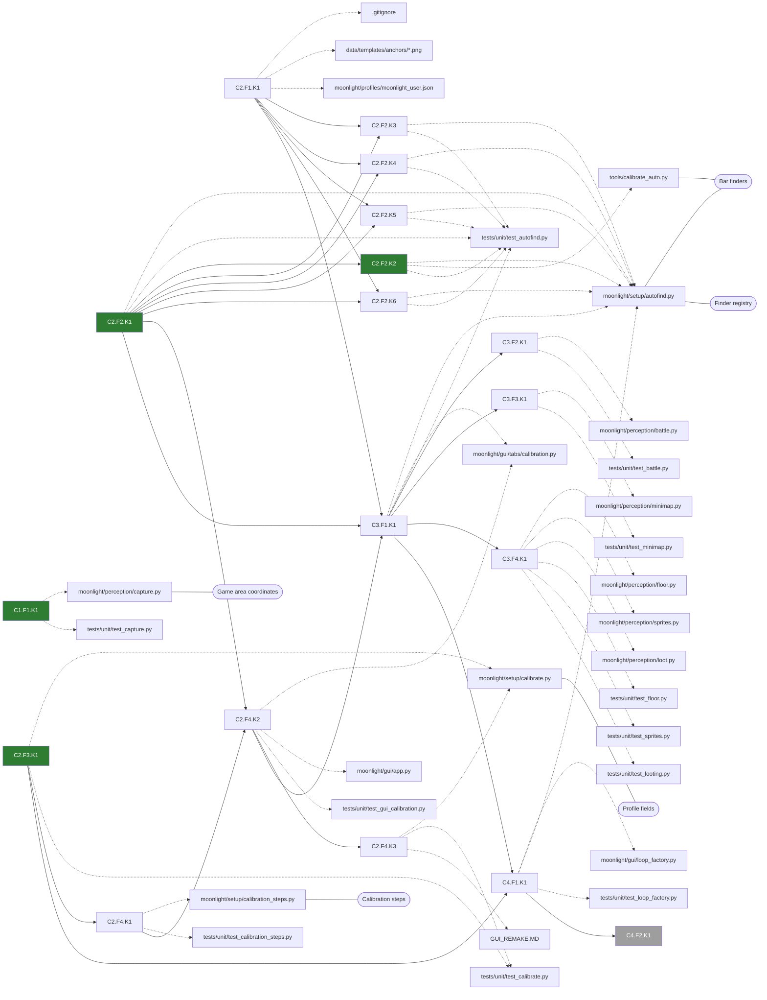

# PR: Calibration remake

Branch `gui/calibration`. One commit per task, one PR at the end.

## Goal

The bot works on any Tibia window size and on servers that move or scale
their UI. In the GUI's **Calibration** tab the user clicks **Start
calibration**, the bot finds every screen area by itself, the user checks and
fixes every box, and Start refuses to run if the layout no longer matches.

## How it works today

- `moonlight/setup/calibrate.py`: an OpenCV window. The user clicks a landmark,
  then drags one box per area in `REGIONS`. Saved to `moonlight/profiles/<name>.json`.
- At runtime the boxes are fixed pixel offsets from the game area's top-left
  corner (`bot/wiring.py`). The landmark is never searched for again.
- HP/MP and the game grid scale with their box. These readers assume fixed
  pixel sizes and break on a scaled UI:
  - `perception/battle.py`: `SLOT_HEIGHT`, `CONTENT_WIDTH`, `TOP_PADDING`, `NAME_START_X`, `HP_BAR_ROWS`
  - `perception/minimap.py`: `RADAR_WIDTH/HEIGHT`, `PLAYER_CENTER_X/Y`
  - `perception/floor.py`, `perception/sprites.py`, `perception/loot.py`: fixed-size template images
- Errors while building the bot are already caught in `gui/app.py`
  (`start_bot`) and logged as "could not start bot". Raise there; don't add popups.

**Already exists, reuse it:**
- `moonlight/setup/autofind.py` → `detect_bars(rgb)` finds the HP and MP bar
  boxes. Checked on 200 screenshots. It takes **RGB**, the rest of the code uses BGR.
- `tests/golden/*.png`: 200 full client screenshots (2560×1369). These are the
  test images for every finder. Gitignored, owner's PC only (R7).
- `moonlight/profiles/moonlight_user.json`: the hand-drawn boxes for those
  screenshots (hp_bar, mp_bar, battle_list, minimap, floor_indicator). They
  are the expected answers.
- `data/templates/anchors/`: reference images, gitignored, owner's PC only
  (C2.F1.K1). Code that uses one treats a missing file as "not found".

## Data shapes

| Thing | Shape |
|---|---|
| Box | `Rect = (x, y, w, h)`, the type in `setup/calibrate.py` |
| Screenshot | numpy `(H, W, 3)` uint8, **BGR** |
| Coordinates | physical pixels, relative to the game area's top-left |
| `ui_scale` | `float` attribute on `CalibrationProfile`, default `1.0` |
| `window_size` | `tuple[int, int] \| None` attribute on `CalibrationProfile`, default `None` |
| Landmark | the found Stop button's top-left, or `(0, 0)` when there is no `stop_button.png` |

## PR rules

These add to [RULESET.md](../../RULESET.md), which wins on conflict.

- **P1. One calibration.** Saving replaces the profile. No per-server or
  per-resolution profiles, no resolution dropdown. The only partial save is
  "Save what you have?" on Esc (C2.F4.K2).
- **P2. One finder per area.** See [Finder registry](#finder-registry).
- **P3. Scale 1.0 changes nothing.** Every reader multiplies its sizes by
  `ui_scale`. At 1.0 each reader behaves exactly as today, so existing tests
  stay as they are.
- **P4. New profile fields are optional.** Old profiles without `ui_scale` or
  `window_size` still load.

## Graph

Tasks (green done, grey later), the files they write, and the concepts those
files link to with `doc:` comments.

<!-- graph:start -->

<!-- graph:end -->

## Concepts

### Game area coordinates

Every box and click is relative to the **client area** (the game picture
without title bar and borders), found with `GetClientRect` + `ClientToScreen`
in `perception/capture.py`. `GetWindowRect` was used before and shifted
everything by the title bar height. Why: the client area is the same size on
every Windows theme and DPI, the outer window is not.

### Finder registry

`moonlight/setup/autofind.py` has a `FINDERS` list, one entry per area:
`(region name, finder function)`. A finder is
`def find_<name>(screenshot: np.ndarray) -> Rect | None`. `find_regions` runs
them all and returns the found boxes plus the names that weren't found. A
finder that returns `None` or raises lands in the missing list.

Add an area = add an entry, a function and a test. Remove it = delete all
three. Finders don't call each other. Why: one broken finder never stops the
others, and each finder can be tested on its own against the golden screenshots.

### Bar finders

`find_hp_bar` and `find_mp_bar` wrap `detect_bars`, which looks for the bars'
fill colours. `detect_bars` was written for RGB, so the finders convert from
BGR first. `tools/calibrate_auto.py` imports it from `autofind.py` instead of
keeping its own copy.

### Profile fields

`CalibrationProfile` stores `window_size` (the game area size at calibration)
and `ui_scale` (see [UI scale](#ui-scale)). Both are read in `from_dict` and
written in `to_dict`, and both are optional (P4). Why: the Start check needs
the size the boxes were drawn at, and the readers need the scale.

### Calibration steps

A plain class (`setup/calibration_steps.py`) walks the 7 areas of `REGIONS`:
keep, redraw or go back on each, then a review of all 7. It knows nothing
about drawing. The Calibration tab (`gui/tabs/calibration.py`) only draws
what the steps say. Why: the step logic is tested headless (R8), and the tab
stays a thin view.

### Reference images

Cropped PNGs in `data/templates/anchors/` (`stop_button.png`,
`battle_list_header.png`, `minimap_frame.png`, `floor_indicator.png`). Image
finders locate them with OpenCV `matchTemplate`. They are gitignored, so
every user of an image treats a missing file as "not found" and its tests skip.

### UI scale

`ui_scale` = found Stop button width ÷ `stop_button.png` width, rounded to
0.05. Each reader multiplies its fixed pixel sizes by it, and template images
are resized by it once when loaded. At 1.0 nothing changes (P3).

### Layout check

Before the loop starts, the client size must equal `window_size` and the Stop
button must still be at the landmark. Otherwise `build_gui_loop` raises
`ValueError("Layout changed, recalibrate")`, which `gui/app.py` already logs.
Missing `window_size` or `stop_button.png` skips that half of the check.

## Tasks

Build order. Status lives in each task file's front matter and shows in the graph.

1. [C1.F1.K1](../tasks/gui-calibration/C1.F1.K1.md) Measure from the game area
2. [C2.F2.K1](../tasks/gui-calibration/C2.F2.K1.md) Finder skeleton
3. [C2.F2.K2](../tasks/gui-calibration/C2.F2.K2.md) HP and MP bar finders
4. [C2.F3.K1](../tasks/gui-calibration/C2.F3.K1.md) Window size and UI scale in the profile
5. [C2.F4.K1](../tasks/gui-calibration/C2.F4.K1.md) Calibration steps (no screen yet)
6. [C2.F4.K2](../tasks/gui-calibration/C2.F4.K2.md) Calibration tab
7. [C2.F4.K3](../tasks/gui-calibration/C2.F4.K3.md) Delete the old calibration window
8. [C2.F1.K1](../tasks/gui-calibration/C2.F1.K1.md) Reference images (Claude makes, owner approves)
9. [C2.F2.K3](../tasks/gui-calibration/C2.F2.K3.md) Battle list finder
10. [C2.F2.K4](../tasks/gui-calibration/C2.F2.K4.md) Minimap finder
11. [C2.F2.K5](../tasks/gui-calibration/C2.F2.K5.md) Floor indicator finder
12. [C2.F2.K6](../tasks/gui-calibration/C2.F2.K6.md) Game grid and status icons finders
13. [C3.F1.K1](../tasks/gui-calibration/C3.F1.K1.md) Measure the UI scale
14. [C3.F2.K1](../tasks/gui-calibration/C3.F2.K1.md) Battle list uses the scale
15. [C3.F3.K1](../tasks/gui-calibration/C3.F3.K1.md) Minimap uses the scale
16. [C3.F4.K1](../tasks/gui-calibration/C3.F4.K1.md) Templates use the scale
17. [C4.F1.K1](../tasks/gui-calibration/C4.F1.K1.md) Check the layout at Start
18. [C4.F2.K1](../tasks/gui-calibration/C4.F2.K1.md) Repeat the check while running (later)

## Owner checks

Collected for the PR. Ticked by the owner.

- [ ] C1.F1.K1: recalibrate once, since the old profile is off by the title bar height.
- [ ] C2.F4.K2: calibrate on the live client and from a golden screenshot, fix one box from the review, Esc and save what you have.
- [ ] C2.F1.K1: approve the anchor crops and the `game_grid` / `status_icons` boxes.
